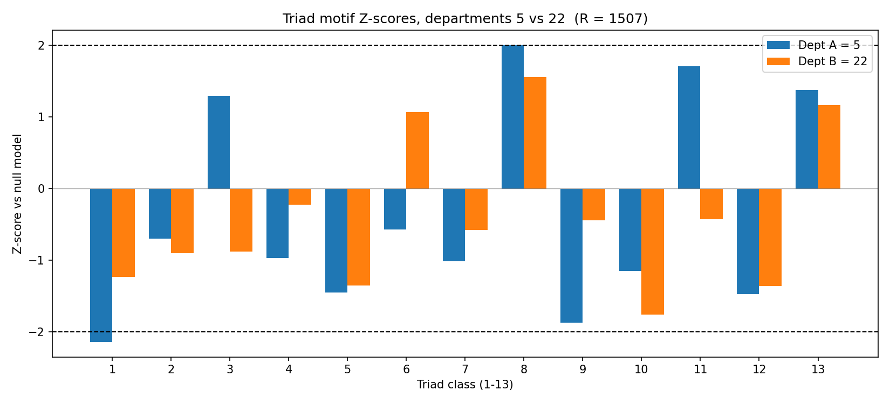

# Network Motifs in email-Eu-core — CS1005 Discrete Structures, Fall 2026

## Group
| Name | Roll number | Section |
|------|-------------|---------|
| Merub Absar Khan | 24I-0611 | CS-A |
| Muhammad Ibragim | 24I-0896 | CS-A |

Group leader: Merub Absar Khan (24i-0611)

## Parameters (R and everything derived from it)
R = 896 + 611 = **1507**

| Parameter | Value |
|---|---|
| Pair number = R mod 190 | 177 |
| Pair (i, j) | (14, 17) |
| Department A = top-20[i] | 5 |
| Department B = top-20[j] | 22 |
| Random networks = 20 + (R mod 31) | 39 |
| Swap attempts = (5 + R mod 6) x edges | 6 x edges |
| Seed | 1507 |

Departments: top-20 index 14 -> **5**, index 17 -> **22** (full printout in `output/run_output_R1507.txt`).

## How to run
1. Make sure `data/` contains `email-Eu-core.txt` and `email-Eu-core-department-labels.txt` (from https://snap.stanford.edu/data/email-Eu-core.html, unzipped). They are already included in this repo.
2. `pip install -r requirements.txt`
3. `python code/main.py` — prints the parameters, counts and Z-scores and writes `output/results_R1507.csv` and `output/zscores_R1507.png`. The roll numbers are already set in `ROLL_NUMBERS` at the top of `code/main.py`.
4. `python code/tests.py` — self-checks (orbit count, brute-force vs fast census, degree preservation)
5. Optional: `python code/main.py --check-nx` compares our counts with `nx.triadic_census` (used ONLY as a check).

## Files
- `code/motifs.py` — triad_class, triad_census, randomize, z_scores (written by us, no graph libraries)
- `code/main.py` — loading/cleaning, top-20, parameters, subgraphs, experiments, chart
- `code/tests.py` — tests
- `data/` — the two SNAP dataset files
- `output/` — chart, results table and run log

## Method summary
- **triad_class**: 6-bit code over the 6 possible edges; canonical code = min over the 6 orderings; 64 labelled configs -> 16 orbits -> 13 connected classes (codes 3,6,7,10,11,15,21,23,25,27,30,31,63).
- **Hand example**: triad 0->1, 1->2, 2->0 sets bits 0, 3, 4 = 1+8+16 = 25 for ordering (0,1,2); the other cyclic orderings also give 25 and the reversed orderings give 38, so the minimum is 25 -> **Class 9**.
- **Counting**: for each node v and each pair of its neighbours (u, w) we classify {v,u,w}. An open path has exactly one centre so it is seen once; a triangle is seen from all 3 nodes so we keep it only from its smallest node. Every connected triple is counted exactly once, without enumerating C(n,3) subsets.
- **Null model**: double-edge swaps, rejected attempts counted; in/out-degrees asserted unchanged.
- **Z-score**: Z = (N - mean) / population std over the random graphs; Z = 0 if std = 0. Motif if Z > 2, anti-motif if Z < -2.

## Results
Department A = **5** (18 nodes, 147 edges); Department B = **22** (25 nodes, 118 edges).
Cleaned graph: 1005 nodes, 24,929 edges (642 self-loops/duplicates removed from the 25,571 raw lines).
39 random networks per department, 6 x edges swap attempts, seed 1507. Triad counts verified against `nx.triadic_census` (used only as a check; it uses a different class order).

| Class | A count | A mean (random) | A Z | B count | B mean (random) | B Z |
|---|---|---|---|---|---|---|
| 1 | 8 | 15.97 | -2.15 | 4 | 6.72 | -1.23 |
| 2 | 20 | 24.20 | -0.70 | 4 | 6.36 | -0.90 |
| 3 | 61 | 53.64 | 1.29 | 62 | 66.00 | -0.88 |
| 4 | 12 | 16.15 | -0.97 | 3 | 3.41 | -0.23 |
| 5 | 11 | 19.77 | -1.45 | 2 | 4.03 | -1.36 |
| 6 | 22 | 24.69 | -0.57 | 27 | 24.97 | 1.06 |
| 7 | 39 | 45.18 | -1.02 | 15 | 18.72 | -0.58 |
| 8 | 62 | 47.20 | 2.00 | 50 | 38.05 | 1.56 |
| 9 | 0 | 3.41 | -1.87 | 0 | 0.20 | -0.44 |
| 10 | 28 | 36.28 | -1.15 | 0 | 3.64 | -1.76 |
| 11 | 29 | 21.97 | 1.70 | 1 | 1.56 | -0.43 |
| 12 | 105 | 116.54 | -1.48 | 38 | 46.18 | -1.37 |
| 13 | 78 | 69.90 | 1.37 | 102 | 97.56 | 1.16 |

Motifs (Z > 2): none. Anti-motifs (Z < -2): Department A class 1 (Z = -2.15). Department B: none.
Department A class 8 shows 2.00 in the table only because of rounding; its exact value is 1.9999, just below the cutoff, so it is NOT a motif by the rule.

## Analysis: how do the two departments communicate differently?
**Department A (5)** shows one statistically significant pattern: class 1 (one person sending to two others, with no replies) is an anti-motif (Z = -2.15; 8 observed vs about 16 expected), and class 8 (a person in mutual two-way exchange with both of two colleagues) sits right at the threshold (Z = 1.9999, about 62 vs 47 expected). So Department A communicates less through one-way broadcast and more through reciprocal exchanges around a central person. **Department B (22)** has no class beyond |Z| = 2: its biggest deviations are mild enrichment of class 8 (Z = 1.56) and class 13 (fully reciprocal triangle, Z = 1.16), and mild under-representation of class 10 (Z = -1.76). Both departments have many class 13 and class 12 triads in raw counts (B has 102 class 13 triads), but their Z-scores are small, which means that is mostly explained by the departments' high degrees rather than extra structure. Overall A shows a clearer reciprocal-versus-broadcast signature, while B is statistically close to its degree-matched random graphs. Caveat: both subgraphs are small (18 and 25 nodes) and we used only 39 random graphs, so Z-scores near +/-2 are unstable.

## Contributions
- **Merub Absar Khan (24i-0611, GitHub: coffeebrowncat)**: wrote `main.py` (data loading and cleaning, top-20 ranking, parameter derivation, department subgraphs, experiment loop, chart), ran the experiments, produced the results tables, organised the repository structure, wrote this README and the analysis. Video: problem, parameters, results.
- **Muhammad Ibragim (24i-0896, GitHub: i240896-cmyk)**: wrote `motifs.py` (triad_class with canonical codes, triad_census, randomize with double-edge swaps, z_scores) and `tests.py`, added `requirements.txt`, uploaded the results files. Video: method and code walkthrough.
- Both: reviewed each other's code, joint explanation segment at the end of the video.

## References
Milo et al. (2002), Network Motifs: Simple Building Blocks of Complex Networks, Science 298(5594).
`nx.triadic_census` used only to verify our counts.
